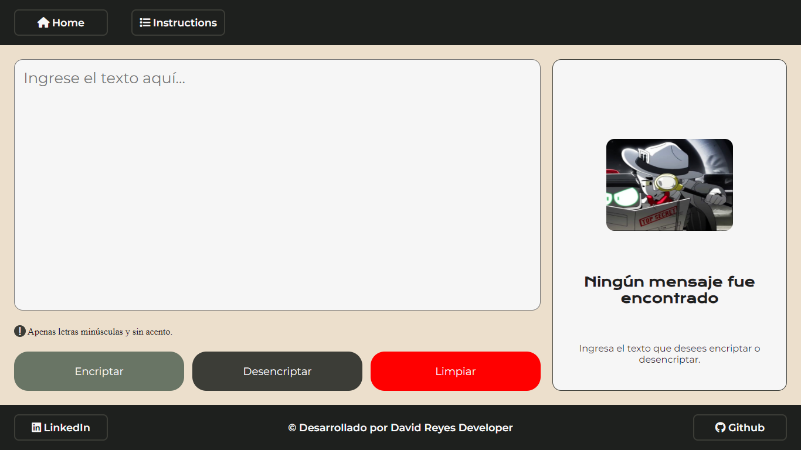

# Encriptador de texto · JavaScript

Aplicación web que **cifra y descifra mensajes** con un conjunto de reglas de sustitución, construida con HTML, CSS y JavaScript puro (sin librerías). Fue mi solución al **Challenge Encriptador de Texto** del programa **Oracle Next Education (ONE) + Alura**.


[](https://juan-roserodev.github.io/text-encryptor-js/)
[](LICENSE)

### 🔗 [Ver demo en vivo](https://juan-roserodev.github.io/text-encryptor-js/)



---

## 🎯 Descripción

El reto consistía en practicar lógica de programación y manipulación del DOM: recibir un texto, transformarlo con reglas fijas y mostrar el resultado con una interfaz clara y responsive.

**Reglas de cifrado**

| Letra | Se reemplaza por |
|---|---|
| `e` | `enter` |
| `i` | `imes` |
| `a` | `ai` |
| `o` | `ober` |
| `u` | `ufat` |

Ejemplo: `gato` → `gaitober`

## ✨ Características

- Cifrado y descifrado con un clic.
- **Validación de entrada:** solo acepta letras minúsculas sin acentos y avisa al usuario si el texto no cumple.
- Botón para **copiar el resultado** al portapapeles (Clipboard API).
- Botón para limpiar y volver al estado inicial.
- Página de instrucciones y diseño adaptable a móvil, tablet y escritorio.

## 🛠️ Stack tecnológico

- **HTML5** semántico
- **CSS3** (Flexbox, media queries)
- **JavaScript (ES6)**: eventos, manipulación del DOM, expresiones regulares y Clipboard API

## 🗂️ Estructura

```
text-encryptor-js/
├── index.html              # Interfaz principal
├── HTML/instrucciones.html # Página de instrucciones
├── CSS/styles.css
├── JS/app.js               # Lógica de cifrado, validación y eventos
└── IMG/
```

## 🚀 Uso local

No necesita instalación ni dependencias:

```bash
git clone https://github.com/juan-roserodev/text-encryptor-js.git
cd text-encryptor-js
```

Abre `index.html` en el navegador (o usa la extensión *Live Server* de VS Code).

## ✅ Buenas prácticas aplicadas

- Separación de estructura (HTML), presentación (CSS) y comportamiento (JS).
- Validación del texto antes de procesarlo, con mensajes claros para el usuario.
- Resultado mostrado con `innerText`, de modo que el texto ingresado no se interpreta como HTML.
- Funciones pequeñas y con un solo propósito (`encriptarTexto`, `desencriptarTexto`, `validarTexto`).

## 👤 Autor

**Juan David Rosero Reyes** · Desarrollador web full stack

[](https://juan-roserodev.github.io/)
[](https://www.linkedin.com/in/david-reyes-dev)
[](mailto:juan.rosero21@hotmail.com)
